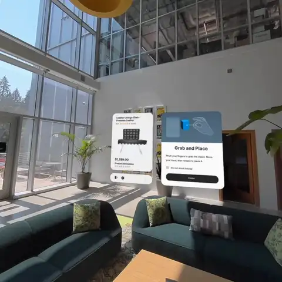
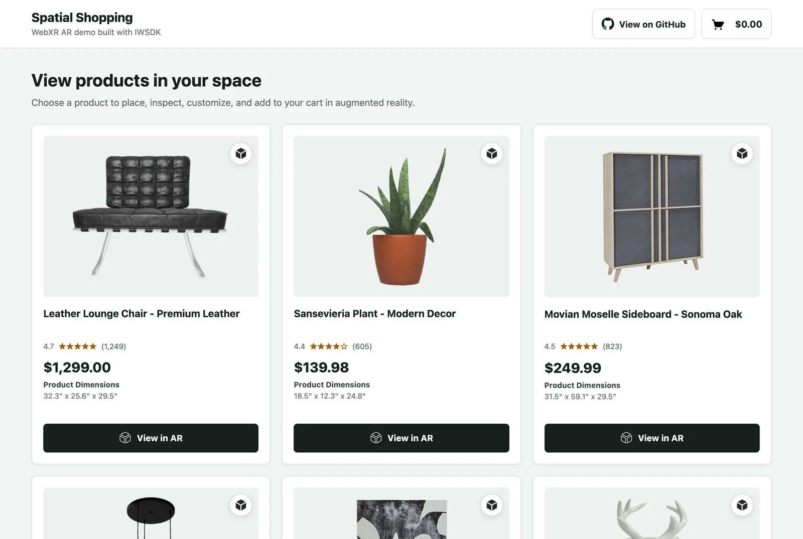

# Spatial Shopping

[](https://github.com/meta-quest/spatial-shopping/actions/workflows/ci.yml)
[](LICENSE)

Place furniture in your real room before you buy it: a WebXR augmented reality
shopping experience for Meta Quest, built with the
[Immersive Web SDK (IWSDK)](https://iwsdk.dev).



<p align="center">
  <a href="https://iwsdk.dev"></a>
  &nbsp;
  <a href="https://github.com/facebook/immersive-web-sdk"></a>
  &nbsp;
  <a href="https://meta-quest.github.io/spatial-shopping/"></a>
</p>

> [!NOTE]
> **This is an IWSDK showcase.** Showcases are complete, open-source apps that
> show how IWSDK features work together in a real product, not isolated
> snippets. Read the code to see how it is done, or fork it as the starting
> point for your own AR commerce experience.
>
> **Start your own IWSDK app in one command:** `npm create @iwsdk@latest`

## Try it

**Live demo:** <https://meta-quest.github.io/spatial-shopping/>

Open the link in Meta Quest Browser, pick a product, and select **View in AR**.
To try it on a desktop without a headset, run it locally: `npm run dev` opens
the IWSDK emulator.

| Device                  | Browser                                                       |
| ----------------------- | ------------------------------------------------------------- |
| Meta Quest 3 / 3S / Pro | Meta Quest Browser                                            |
| Desktop (development)   | Any Chromium browser, with the IWSDK emulator (`npm run dev`) |

The experience requires the WebXR `anchors` and `plane-detection` features.
Chrome on ARCore Android phones exposes plane detection only behind the
`chrome://flags/#webxr-incubations` flag, so Android is untested and
experimental. The page detects AR support on load and says what to use when it
is unavailable.

## What it demonstrates

| Capability                                                            | Where to look                                                              |
| --------------------------------------------------------------------- | -------------------------------------------------------------------------- |
| Scene-aware placement on detected floors and walls, with room setup   | `src/framework/features/PlacementReticle/`, `features/PlaneProcessSystem/` |
| Near and far grab with hands or controllers, two-hand twist to rotate | `src/framework/features/CustomGrab/`                                       |
| Precision move and rotate arrows on floors and walls                  | `src/framework/features/ArrowMover/`                                       |
| Material variants swapped at runtime                                  | `src/framework/managers/product/VariantManager.ts`                         |
| Dimension overlay and Quest depth occlusion                           | `src/framework/features/BoundingBox/`, `managers/scene/SceneManager.ts`    |
| Spatial UI in UIKitML that follows the product and the viewer         | `public/ui/*.uikitml`, `src/framework/ui/`                                 |
| A 2D web page that hands off to AR and gets cart events back          | `src/demo/`, `src/framework/ARViewer.ts`                                   |
| A fast first paint, with the XR runtime loading in the background     | `src/demo/index.ts`                                                        |

## How it plays

| Action             | Hands                                   | Controllers                             |
| ------------------ | --------------------------------------- | --------------------------------------- |
| Grab and place     | Pinch the product, move, release        | Point, hold the trigger, release        |
| Rotate             | Pinch with both hands and twist         | Hold both triggers and twist            |
| Fine-tune position | **Manipulate**, then pinch the arrows   | **Manipulate**, then trigger the arrows |
| Change the finish  | Hover the product, or open **Variants** | Point at the product, or **Variants**   |
| Check the size     | **Show Dimensions**                     | **Show Dimensions**                     |
| Buy                | **Add to Cart**, then **View Cart**     | **Add to Cart**, then **View Cart**     |

The control rail next to the product also has **Show Details**, **Enable
Occlusion** (Quest only), and **Exit**. The first time you open a product, a
short tutorial walks through grabbing, variants, and rotating.

## Run it locally

Requires Node.js `22.12+` or `24+` and npm.

```bash
git clone https://github.com/meta-quest/spatial-shopping.git
cd spatial-shopping
npm ci
npm run dev
```

`npm run dev` starts an HTTPS development server and opens a browser with the
IWSDK emulator, so you can try the whole AR flow on a desktop. Use
`npm run dev:status` to print the network URL for a headset, and
`npm run dev:down` to stop the server. A headset shows a certificate warning
for the development certificate; that is expected.

| Command                 | Purpose                                       |
| ----------------------- | --------------------------------------------- |
| `npm run dev`           | Start the dev server and emulator             |
| `npm run check`         | Format check, lint, typecheck, and unit tests |
| `npm run build`         | Production build into `dist/`                 |
| `npm run preview`       | Serve the production build locally            |
| `npm run test:coverage` | Run unit tests with coverage                  |

Run `npm run check` before opening a pull request; CI runs the same gate.

## Code map

| Area                                  | Files                                                                   |
| ------------------------------------- | ----------------------------------------------------------------------- |
| Catalog page and mock product service | `index.html`, `src/demo/`                                               |
| AR runtime facade                     | `src/framework/ARViewer.ts`                                             |
| Startup, XR launch, room checks       | `src/framework/managers/initializer/`                                   |
| Product loading, variants, occlusion  | `src/framework/managers/scene/`, `managers/product/`                    |
| Session and cart state                | `src/framework/managers/session/`                                       |
| Placement, grab, arrows, dimensions   | `src/framework/features/`                                               |
| Spatial panels                        | `src/framework/ui/`, `public/ui/*.uikitml`                              |
| Runtime configuration                 | `src/framework/config/`, `iwsdk.config.json`                            |
| Assets                                | `public/demo/` (catalog), `public/3dUI/`, `public/hdr/`, `public/imgs/` |

## Make it your own

### Connect your catalog

Products come from `VendorService` (`src/demo/services/`), which reads
`public/demo/data/vendor-products.json`. Replace it with calls to your own
catalog API that return the same `ProductData` shape. Model and material
requirements are in [Asset Preparation](docs/guides/AssetPreparation.md).

Some demo models stream from the Amazon Berkeley Objects dataset and need
network access; the lounge chair and plant are bundled for offline work.

### Connect your cart

The page talks to the AR runtime through one class, `ARViewer`:

```ts
import { ARViewer } from "./framework/ARViewer.js";
import { AddToCartFailureReason } from "./framework/managers/session/AddToCartFailureReason.js";

const viewer = ARViewer.getInstance();

viewer.setCartProductAddedCallback(async ({ addId, addedProduct }) => {
  try {
    await commerceApi.add(addedProduct.id, addedProduct.quantity);
    viewer.onAddToCartSuccess(addId);
  } catch {
    viewer.onAddToCartFailure(AddToCartFailureReason.NetworkConnection, addId);
  }
});

viewer.setXRExperienceQuitCallback(() => showCatalog());

await viewer.init();
await viewer.open(product); // call from a click handler
```

Each add stays pending until the page calls `onAddToCartSuccess(addId)` or
`onAddToCartFailure(reason, addId)`; a failure removes the item from the in-AR
cart again. Callbacks may be async. If one throws or rejects, the add is rolled
back and the error goes to the error callback instead of breaking the AR
session. With no add-to-cart callback registered, adds commit immediately.



## Build your own with IWSDK

Spatial Shopping is built entirely on the
**[Immersive Web SDK](https://iwsdk.dev)**: a TypeScript framework for WebXR
apps with an ECS runtime, hand and controller interactions, spatial UI,
locomotion, physics, an emulator for desktop development, and tooling for AI
coding agents. Scaffold a new project in seconds:

```bash
npm create @iwsdk@latest
```

<p align="center">
  <a href="https://iwsdk.dev"></a>
  &nbsp;
  <a href="https://github.com/facebook/immersive-web-sdk"></a>
</p>

| Next step                                   | Link                                                                            |
| ------------------------------------------- | ------------------------------------------------------------------------------- |
| Read the guides, concepts and API reference | **[iwsdk.dev](https://iwsdk.dev)**                                              |
| Explore the SDK source and examples         | **[facebook/immersive-web-sdk](https://github.com/facebook/immersive-web-sdk)** |
| Install the core package                    | **[@iwsdk/core on npm](https://www.npmjs.com/package/@iwsdk/core)**             |

If this showcase helped you, **[star IWSDK on GitHub](https://github.com/facebook/immersive-web-sdk)**
and share what you build.

## Contributing

See [CONTRIBUTING.md](CONTRIBUTING.md) for the development workflow and the
Contributor License Agreement. Please report security issues through the
process in [SECURITY.md](SECURITY.md), not public issues.

The repository also includes guidance for AI coding agents (`AGENTS.md`,
`.agents/`, `.cursor/`, `.github/instructions/`). It describes IWSDK
conventions and can be ignored if you don't use those tools.

## License

Spatial Shopping is [MIT licensed](LICENSE). Third-party assets keep their own
licenses; see [THIRD_PARTY_ASSETS.md](THIRD_PARTY_ASSETS.md).
